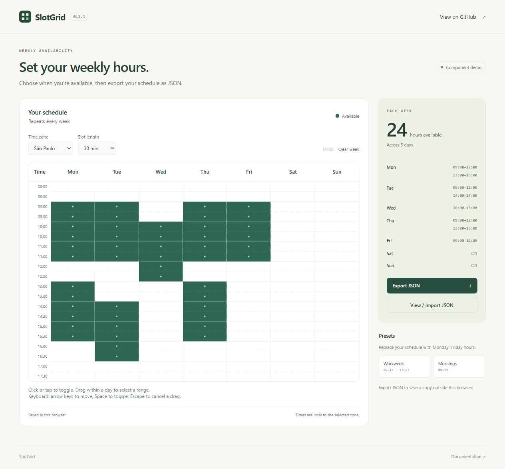

# SlotGrid

A `<slot-grid>` web component for editing recurring weekly availability. Schedules use JSON; overlapping ranges merge automatically. No runtime dependencies.

[Try the demo](https://almeida96.github.io/slotgrid/)



## Run locally

Requires Node.js 22+ and pnpm 11.25.0.

```sh
git clone https://github.com/Almeida96/slotgrid.git
cd slotgrid
pnpm install --frozen-lockfile
pnpm run build
pnpm run dev
```

Open `http://127.0.0.1:4173`. Rebuild after editing the source.

## Use the component

Copy `dist/slot-grid.js` from a build into your project. Load it as an ES module:

```html
<slot-grid></slot-grid>

<script type="module">
  import './slot-grid.js';

  const grid = document.querySelector('slot-grid');
  grid.value = {
    version: 1,
    timeZone: 'America/Sao_Paulo',
    step: 30,
    slots: [
      { day: 1, start: '09:00', end: '12:00' },
      { day: 1, start: '13:00', end: '17:00' }
    ]
  };

  grid.addEventListener('slotgrid-change', event => {
    console.log(event.detail);
  });
</script>
```

The `value` property validates input and returns a detached copy. Assigning it does not emit an event. User edits emit `slotgrid-change` with the complete schedule in `event.detail`; a drag emits once on release. Set `grid.disabled = true` to disable editing.

Importing the module registers `<slot-grid>`, which uses Shadow DOM. In server-rendered apps, import it on the client. Type declarations are in `dist/`.

You can also install the archive from [Releases](https://github.com/Almeida96/slotgrid/releases), or run `pnpm pack` after building to create one. The package is not on npm.

## Schedule format

| Field | Meaning |
| --- | --- |
| `version` | `1` |
| `timeZone` | A time zone accepted by `Intl.DateTimeFormat`, such as `UTC` or `America/Sao_Paulo` |
| `step` | `15`, `30`, or `60` minutes |
| `slots` | Ranges with `day`, `start`, and `end` |
| `day` | `1` for Monday through `7` for Sunday |
| `start`, `end` | `HH:MM` in 24-hour time; `24:00` is allowed only as an end |

Ranges are half-open: `09:00–10:00` includes 09:00 and ends at 10:00. Boundaries must align to `step`. Overlapping and adjacent ranges on the same day merge automatically. Empty days have no ranges. Overnight availability must be split across two days.

Schedules repeat weekly in the selected time zone. Changing `timeZone` keeps the selected hours. Your application must handle dates, daylight-saving changes, holidays, and booking conflicts.

## Controls

- Click or tap a cell to toggle it.
- Drag vertically within one day to add or remove a range. Starting on a selected cell removes availability.
- Use arrow keys to move, Space or Enter to toggle, Home/End to move across a row, and Ctrl+Home/Ctrl+End to move to the first/last cell.
- Press Escape during a drag to cancel it. A canceled pointer gesture also restores the previous schedule.
- On touchscreens, tap cells and swipe to scroll; dragging to paint is reserved for mouse and pen input.

The grid has one tab stop, named cells, selection states, and a live total. The visible range starts at 08:00–18:00 and expands to include any earlier or later imported slots. Narrow screens scroll the grid horizontally.

## Model functions

`dist/model.js` works without a DOM and can be imported on a server:

```js
import { emptySchedule, setRange, totalMinutes } from './dist/model.js';

const week = setRange(emptySchedule('UTC', 30), 1, '09:00', '12:00', true);
const withBreak = setRange(week, 1, '10:00', '10:30', false);
console.log(totalMinutes(withBreak)); // 150
```

`normalizeSchedule(value)` validates and returns a sorted, merged copy. `setRange(schedule, day, start, end, available)` adds or removes availability without mutating its input. `parseTime` and `formatTime` convert between `HH:MM` and minutes since midnight. Invalid input throws an error.

## Styling

Set CSS properties on the host element. The component does not load fonts or external stylesheets.

```css
slot-grid {
  --slotgrid-accent: #2e6654;
  --slotgrid-selected-text: #ffffff;
  --slotgrid-background: #ffffff;
  --slotgrid-border: #e1e6e1;
  --slotgrid-text: #253e35;
  --slotgrid-muted: #6a7e73;
  --slotgrid-hover: #eef3e9;
  --slotgrid-focus: #b66d23;
}
```

## Development

```sh
pnpm run check
pnpm run build
pnpm test
pnpm pack --out slotgrid-0.1.1.tgz
pnpm run pack:check
```

Tests cover range normalization, subtraction, validation, JSON round trips, keyboard controls, disabled state, and change events. A seeded test compares range operations against a separate cell model. Component tests use Happy DOM; check pointer behavior and layout in a browser.

The GitHub Actions workflow runs checks on Linux, Windows, and macOS. The Pages job deploys the demo after those checks pass on `main`.

## Demo storage

The component does not store data or make network requests. The demo saves the last schedule in local storage and keeps up to 30 undo states in memory. Clearing browser storage removes the saved schedule. Export JSON to keep a copy.

MIT license. See [LICENSE](LICENSE).
